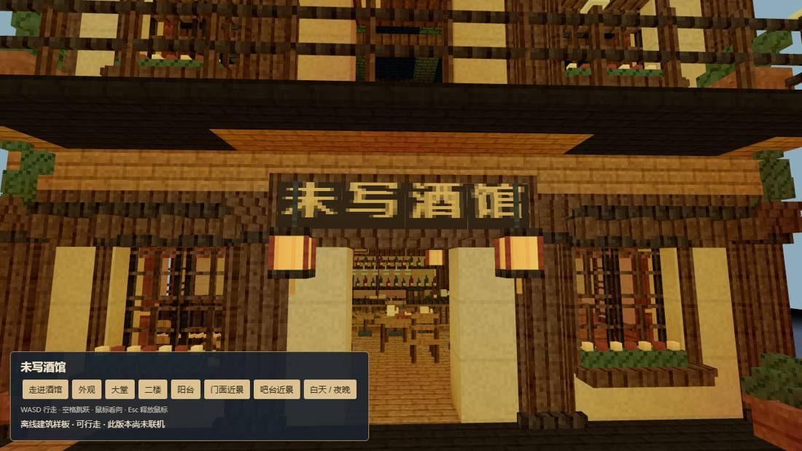
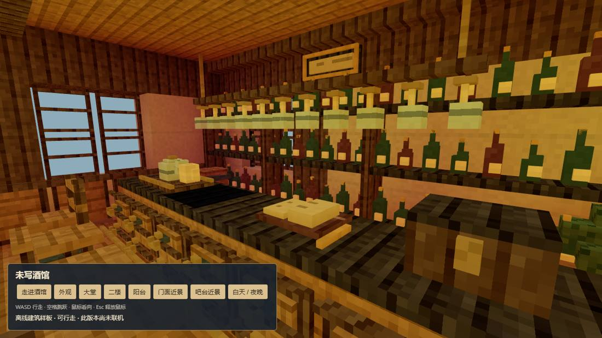
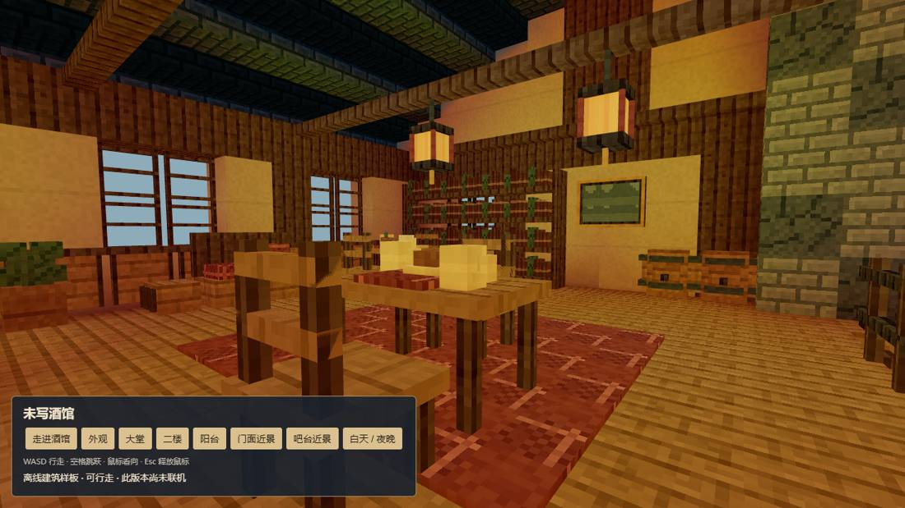

# UNWRITTEN 2027

朋友通过网页链接进入的第一人称多人跨年雪镇：纪念馆、邮局、酒馆、集市、湖岸游览和跨年仪式。目标在 2026-12-31 开放，之后可扩展春节内容。

## 当前状态

**酒馆的方块风格和基础结构已获用户认可，正在以完整酒馆为样板精修；尚未迁移全镇。**

| 入口 | 已有内容 | 当前边界 |
| --- | --- | --- |
| 旧多人主入口 `src/` | 昵称、位置、文字聊天、邮局/纪念馆及部分三维建筑；Node/WebSocket 服务 | 保留可运行基线，尚未改成新体素小镇 |
| 体素酒馆 `tools/voxel-tavern/` | Voxelize + Three.js，逐块建筑、像素材质和细构件；外观、完整室内、楼梯、阳台 | 当前为离线建筑样板；新联机、手机性能和最终美术尚未验收 |

酒馆已通过前端类型检查、生产构建和 Windows Chrome 实机检查。门外 → 大堂 → 楼梯 → 二楼 → 阳台的连续碰撞行走通过，途中没有传送。旧版双客户端同步检查不能当作新版联机或全镇容量结论。

## 第三版酒馆实机画面





## 技术与制作

酒馆客户端采用 Voxelize 3.0.0、Three.js 0.183.2、TypeScript 和 Vite。JavaScript 脚本逐块搭建墙体、半砖屋顶与家具，细部对齐到 1/16 米；同一份构件尺寸用于生成表面和碰撞盒，配合原创 16 像素材质，由引擎在浏览器中生成分块网格。

新联机后端首选 Voxelize/Rust，须先重新编译和验证当前酒馆。旧主入口仍采用 Three.js/Rapier + Node.js/ws，两套协议尚未合并。

## 查看已有工程

旧多人主入口需要 Node.js 22.20+：

```sh
npm ci
node tools/run.mjs dev
```

体素酒馆样板：

```sh
cd tools/voxel-tavern
npm ci --ignore-scripts
node build-tavern.mjs
node node_modules/vite/bin/vite.js build
node node_modules/vite/bin/vite.js preview --host 127.0.0.1 --port 5179
```

在运行这套命令的电脑打开 `http://127.0.0.1:5179/?snapshot=1`。使用生产预览验收；当前发布包在开发预打包模式存在 Worker 路径问题。该地址是本机查看地址，不是已经部署的公网游戏链接。

## 文档与后续计划

- [当前技术总结、制作流程和分阶段计划](docs/PLAN.md)
- [当前美术要求及历史参考](docs/ART.md)
- [酒馆样板的运行方式与验收边界](tools/voxel-tavern/README.md)
- [旧 Node 运行时和协议](docs/architecture.md)

2026-11-16 本轮仅整理方案并推送已有成果；后续精修、手机适配、新联机、全镇迁移与部署均按计划待执行。

目录继续使用 `src/`、`public/`、`assets-source/`、`tools/`、`tests/`、`docs/`。保留 MIT [Friendslop Base](https://github.com/larshurrelb/friendslop-base) 和 [Voxelize](https://github.com/voxelize/voxelize) 的许可与署名。旧 Blender/GLB 资产仍服务于旧主入口，当前不删除。
