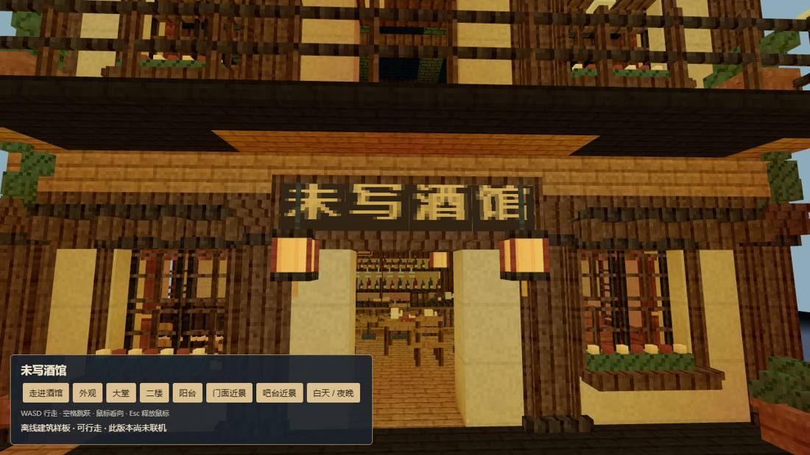
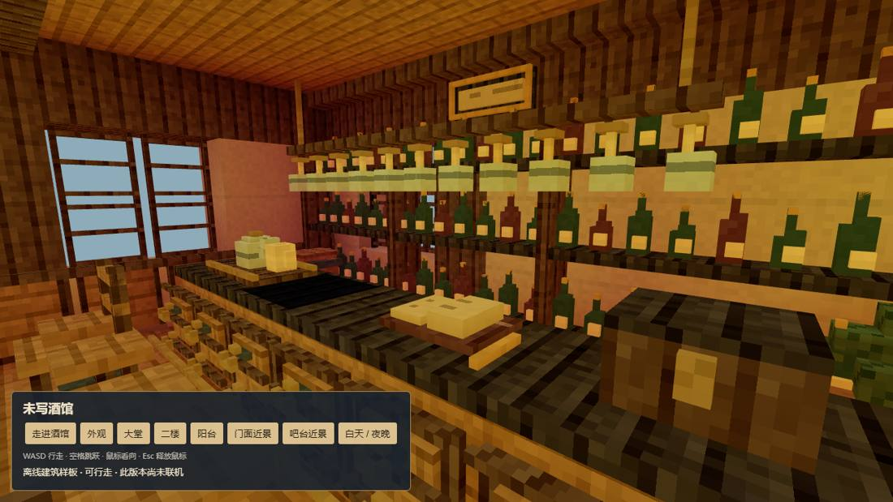
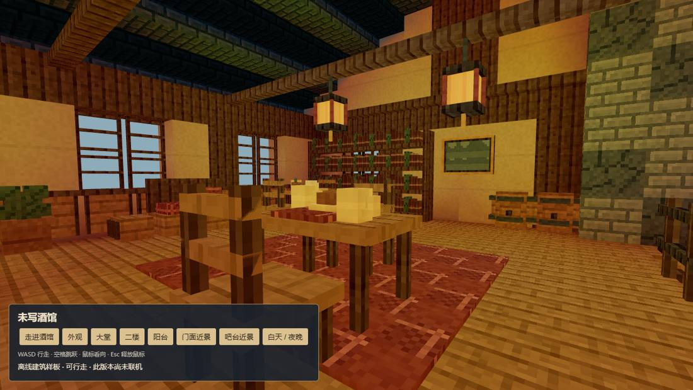

# UNWRITTEN 2027：技术总结与后续计划

更新：2026-11-16，北京时间。本文为当前需求和后续工作的统一入口；旧方案与执行流水见 Git 历史。

**2026-11-17 进度**：`town-blockout-integration` 已有四区雪夜、四座桥、可进入的重点建筑和本机互动，可在 `/town-blockout.html?visit=museum` 试玩。当前步行与碰撞验收见 [小镇初搭与步行验收](TOWN-BLOCKOUT.md)。下文保留 11 月 16 日的阶段安排。P1 的完整酒馆美术验收和手机真机性能、P2 的新版 Rust 联机及 P3 的同镇同步仍待完成。

## 1. 已确认的目标与边界

- 朋友点网页链接、取昵称即可进入；无需安装 Minecraft、客户端或额外模组。PC 与手机均需适配。
- 有限、人工设计的雪夜小镇；无需无限地形和完整的 Minecraft 方块/生存系统。
- 默认第一人称，允许在合照和舞台等场合自愿切换外部视角；实时显示其他玩家与昵称。
- 美术以参考视频②③为主：明确的方块搭建结构、精细木构和丰富内饰，允许整栋使用小方块。光影根据访问设备性能分档。
- 用户已认可第二版酒馆的方块风格与基础结构，要求在此基础上继续精修。第三版已补充木作节点、窗帘、字牌、吧台五金和生活陈设；最终参考视频级精度仍待验收。
- 制作工具由方便搭建、易修改与运行效果决定。纯色长方体粗模已被否决，不以最小网格或构件数量代替视觉验收。
- 游客以参观和互动为主，不能自由拆毁建筑或改地形。共同建设通过指定装饰、收集与点亮等机制实现。
- 验收对象是**完整酒馆：外观、完整室内和连续行走**。先把酒馆验收做实，再决定全镇迁移。
- 一个仓库、一个最终实时世界服务，保留简洁目录。旧工程保留可运行基线，迁移按建筑和功能逐项替换。
- 后续生图使用用户网页端；已有概念图作为设计参考。酒馆当前使用程序搭建和真实浏览器截图，没有调用工作端生图额度。

参考：

1. [一砖一瓦，一人一镇](https://b23.tv/ruSpbar)
2. [下着雨的小镇……](https://b23.tv/fSGOmuw)
3. [你愿意生活在这样的 MC 小镇里吗？](https://b23.tv/AKQvbBc)

“爱丽丝”路线保留其设定、拆资产、做样板、进游戏检查、反复精修的顺序；当前建筑通过体素构件实现。详见 [ART.md](ART.md)。

## 2. 技术栈：当前状态与目标路线

| 层级 | 酒馆样板采用 | 已实现或待验证 |
| --- | --- | --- |
| 体素引擎 | Voxelize，npm / Rust 发布版固定 3.0.0 | 自定义复合方块、分块网格、碰撞和控制器已用于离线酒馆 |
| 网页渲染 | Three.js 0.183.2 / WebGL | PC 浏览器实机渲染通过，手机性能待测 |
| 前端 | TypeScript 5.9 / Vite 6.4.1 | 类型检查、生产构建通过；样板用生产预览验收 |
| 建筑与陈设 | JavaScript 搭建脚本，1 米基准块及局部 1/16 米细构件 | 同一份构件数据生成可见表面与碰撞盒 |
| 材质 | 原创 16 像素纹理、共享图集 | 木纹、砖缝、瓦片、布料、字牌和装饰材质已显示 |
| 光照 | 方块光照数据 + 引擎着色、环境遮蔽与现有阴影 | 样板支持昼夜查看；高低画质和手机预算待测 |
| 新世界服务端首选 | Voxelize / Rust + WebSocket | 早期小样编译和双客户端位置同步通过；当前修改后的注册表代码尚未重编译及复测 |
| 当前旧主游戏 | TypeScript / Three.js 0.180 / Rapier + Node.js / ws | 仍位于 src/，已有昵称、聊天、邮局、纪念馆等功能，尚未迁入新体素世界 |
| 部署准备 | 现有 Compose / Caddy 配置、计划中的游戏子域 | 配置针对旧 Node 运行方式；新服务端确定后再调整，当前未部署 |

旧主游戏复用 MIT 的 [Friendslop Base](https://github.com/larshurrelb/friendslop-base)，体素样板复用 MIT 的 [Voxelize](https://github.com/voxelize/voxelize)。继续保留许可与署名。

客户端和建筑工具沿用当前体素方案继续验证。新联机后端以 Rust 世界服务为首选，须经过新版编译、同步与性能验收后锁定。现有 Node 业务按接口和数据语义复用，不假定两套角色协议、物理或坐标系统直接兼容，不同时维护两套玩家位置权威。

### 当前仓库与入口

- 仓库：[disdorqin/unwritten-2027](https://github.com/disdorqin/unwritten-2027)。
- 旧多人主入口：仓库根目录的 src/、public/，按根 README 运行。
- 新酒馆样板：[tools/voxel-tavern/](../tools/voxel-tavern/)，独立验证入口，尚未替换旧主入口。
- 当前旧运行时协议说明：[architecture.md](architecture.md)；不把该文档直接当作新体素后端说明。

## 3. 酒馆是怎样做出来的

1. **布局与逐块搭建**：`build-tavern.mjs` 描述墙面、地板、半砖屋顶、楼梯及家具的位置；基础建筑按块搭建，细部按 1/16 米网格对齐。
2. **精修构件**：`refine-tavern.mjs` 添加柱脚、檐下支撑、窗楣窗台、窗帘、护墙板、字牌、抽屉拉环、茶具、账本及杯架；陈设留出实际通道。
3. **复合方块注册**：构件在体素单元边界裁切，相同形状复用注册定义；一份尺寸数据同时生成表面和 AABB 碰撞盒，避免只看得见却无法走入。
4. **像素材质**：`textures.ts` 通过 Canvas 绘制原创纹理，分配到共享图集；字牌也是实际游戏表面上的材质。
5. **离线样板数据**：脚本生成 `tavern.json` 与 `snapshot.ts`。当前 snapshot 是程序创作的离线世界，不是新版实时服务器导出的录像。
6. **运行与修正**：Voxelize 客户端加载九个地图块，实际生成网格、执行角色碰撞；在 Windows Chrome 生产构建中截图，并用前进/转向输入检查整栋行走。

生成数据、编译产物与开发依赖在本地使用；仓库不提交 node_modules、target 或临时浏览器记录。样板运行方法见 [酒馆 README](../tools/voxel-tavern/README.md)。

### 已验证和未验证必须分开

| 内容 | 当前证据 |
| --- | --- |
| 方块风格与基础结构 | 用户已认可第二版；第三版继续精修，未宣布最终美术通过 |
| PC 实机画面 | 外观、大堂、二楼、阳台、门面近景、吧台近景已检查；浏览器无运行错误 |
| 连续行走 | 门外 → 大堂 → 楼梯 → 二楼 → 阳台通过；仅在起点放置角色，途中不传送 |
| 前端检查 | 类型检查、生产构建通过 |
| 新联机 | 早期双客户端位置同步通过，当前新建筑和修改后的服务端未完成新版验收 |
| 坐下、舞蹈、其他互动 | 未实现；更换体素引擎不会自动获得这些功能 |
| 手机、容量与公网 | 未验收；旧版短时协议测试和小样内存不能当作全镇容量结论 |

第三版实机截图：

## 4. 延续此前方案的世界内容

目标仍为 2026-12-31 正式开放、春节可延展。核心体验是共同回望 2026、迎接 2027，并保留参与成果。

| 建筑或区域 | 内容与优先级 |
| --- | --- |
| 中央钟楼广场 | 北京时间 2027-01-01 00:00 的唯一正式跨年；倒计时、全员传送、共同点亮、烟花、合照、钟声；主持公告与流程控制 |
| 2026 纪念馆 | 公共年度内容，不放个人展区；按月长廊，约 24–36 项、国内约 70%；重要事件互动，其余图文，由用户筛选候选 |
| 新年邮局 | 写给 2027 的信、纪念明信片与盖章；接收范围包括自己、指定游戏昵称和张乐天 |
| 酒馆、冬日集市、住店 | 室内社交、坐下、闲逛、固定氛围音乐；不先扩展点歌和曲库 |
| 演出舞台 | 预设站位、基础动作与观众回应；复杂舞蹈、自由编舞和真人动作捕捉不先做 |
| 旋转木马与游乐区 | 先做好一个可重复参与的乘坐循环；轻竞技作为扩展，不抢占核心内容 |
| 灯塔、木桥、愿望树 | 湖岸游览、观景与共同点亮；愿望与公共成果需持久化 |
| 森林木屋、普通民居 | 形成街区和视线背景，复用构件，多数只需外观 |

布局延续中央广场、右上集市与酒馆、左上森林木屋、下方游乐区以及冰湖、木桥、灯塔；动线强调纪念馆 → 游乐区 → 广场。随机入场使用预先检查的安全出生点。

公共祝福可直接展示；图片和展品审核后公开。昵称关系问答允许跳过和不再提示，说明答案按游戏昵称提供给张乐天。私信与公开祝福使用不同可见范围，不广播私人信件，也不承诺昵称无法关联现实身份。

首版继续暂缓语音、点歌、独立个人展区、完整账号系统和跨设备身份恢复。轻量内部访客标识仍需用于重连、去重和信件归属。

## 5. 原阶段安排

以下为建议窗口，以前一阶段验收结果为依据；日期不是已完成声明。未通过酒馆美术、手机与新联机验证前，不批量迁移全镇。

| 阶段与建议时间 | 后续工作 | 验收条件 |
| --- | --- | --- |
| P0 · 11/16，本轮 | 汇总技术、制作方式、证据边界和计划；推送现有样板及文档 | 仓库可审阅，运行入口和未完成项明确；不开发后续功能 |
| P1 · 11/17–11/22 | 精修酒馆至统一样板标准；整理可复用门窗、屋瓦、家具、灯具；优化批次、图集、可见性与光影档位；接入手机控制 | 完整外观/室内由用户看实机验收；PC 与真实手机走完整路线；无明显卡点和持续卡顿 |
| P2 · 11/23–11/27 | 重新编译新 Rust 服务端；先把完整酒馆接入新联机，再做坐下、聊天与重连；明确单一世界服务和旧业务适配方式 | 两台真实设备互见昵称/位置/动作；座位占用和离座一致；刷新、断线、重复请求正确；服务端限制非法改块和越界状态 |
| P3 · 11/28–12/06 | 样板全部通过后分批搭有限小镇；先纪念馆、邮局与广场，再补钟楼、桥、灯塔；普通民居复用外观，主要建筑逐个精修 | 比例、街道、楼梯和碰撞一致；每座主要建筑可实际进入；同镇同步，不以批量粗模代替完成 |
| P4 · 12/07–12/13 | 接回纪念馆内容、邮局、祝福墙、愿望和纪念收集；固定背景音乐、收集后共同点亮 | 一段完整游玩闭环；私信不泄露给旁观者；持久化、去重、重连和重启恢复通过；年度内容有来源 |
| P5 · 12/14–12/20 | 加入木马单轮乘坐、舞台基础动作与观众回应；完成服务器统一倒计时、零点传送、钟声、烟花和合照 | 使用模拟零点反复彩排；迟加入、断线重连可恢复当前环节；仪式奖励和公共成果不重复提交 |
| P6 · 12/21–12/27 | 确认服务器与域名条件，部署稳定测试版；真实手机/PC 联合体验，逐级增加并发，测慢网与重启，完成整场彩排 | 公网 HTTPS/WSS 可用；形成实测容量与画质建议；备份可恢复；核心流程没有阻断问题 |
| P7 · 12/28–12/31 | 冻结功能，修复阻断问题，确认内容、主持流程、备份和访问链接 | 再做一遍完整流程与模拟零点，正式开放；非核心内容可延至春节版本 |

内容整理与场景开发并行。11–12 月年度事件按实际发生与来源核实后补齐，十二月展位当前保留。

### 验收重点

- **画面**：检查全景、第一人称近景和昼夜效果；构件尺寸与装饰密度协调，有生活痕迹，同时保留通道。用户已认可的方块风格不再退回纯色粗模。
- **手机**：实际验证触控移动、转向、交互按钮、横竖屏与文字输入。建议目标为 PC 接近 60 FPS、手机低画质稳定 30 FPS，并记录首次加载、内存与长时间行走的表现；以真机结果调整预算。
- **联机**：服务器管理座位、互动结果、仪式与保存；复用客户端表现层，不能直接信任客户端的占用、奖励或世界修改请求。新旧协议和角色坐标先做适配验证。
- **容量**：分档逐步加压，不把 20 人设为业务上限，也不把旧协议的 255 人编码边界当作实际容量。达到当前机器瓶颈时，记录瓶颈后再决定优化、分房或升级。
- **资源**：优先共享图集、合批/实例化、分块与距离细节；手机降低阴影、分辨率与动态灯数量。光影主要消耗访问设备的 GPU，服务器主要承担同步、逻辑和数据。
- **数据**：公共祝福、审核后的图片/展品、私信、共同点亮与仪式进度分别定义可见范围和保存方式。沿用旧功能的正确性约定，不能把移植等同于简单复制文件。

## 6. 部署条件与范围取舍

此前截图为朋友的 2 核 / 2GB 内存、50GB 磁盘、4Mbps 带宽服务器。2GB 是运行内存，不是允许上传的代码体积。旧小样内存数据不代表新版全镇容量。

后续部署只上传静态构建产物、Release 服务端、必要生产依赖和数据；开发用 target、开发依赖、Blender 工程、参考视频与 .git 不作为运行包上传。优先在开发机或构建环境编译，避免让小服务器承担重型开发构建。

计划使用博客域 disdorqin.cn 下的游戏子域 town.disdorqin.cn。DNS、HTTPS 和服务器内部配置尚未验收，当前仍等待可用的服务器登录与域名管理通道。此前截图到期日为 2026-12-12，正式部署前须核实是否已续期，确保覆盖跨年。

如果进度或性能不足，优先保住：昵称进入、流畅移动与聊天、精致核心街区、纪念馆、邮局/祝福、可靠的跨年仪式。先缩减外围可进入建筑、额外游乐设施与复杂舞台动作，保留主要建筑的精细质量。

当前小镇已开始单人场景和交互动线验证。正式开放仍按 P2–P7 的联机、内容、仪式和部署验收推进。
