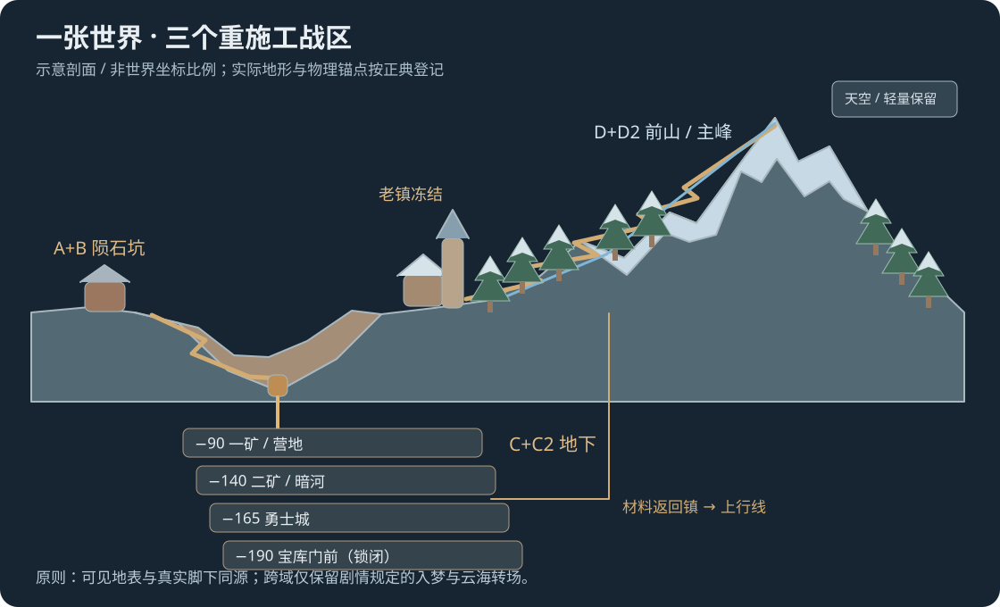
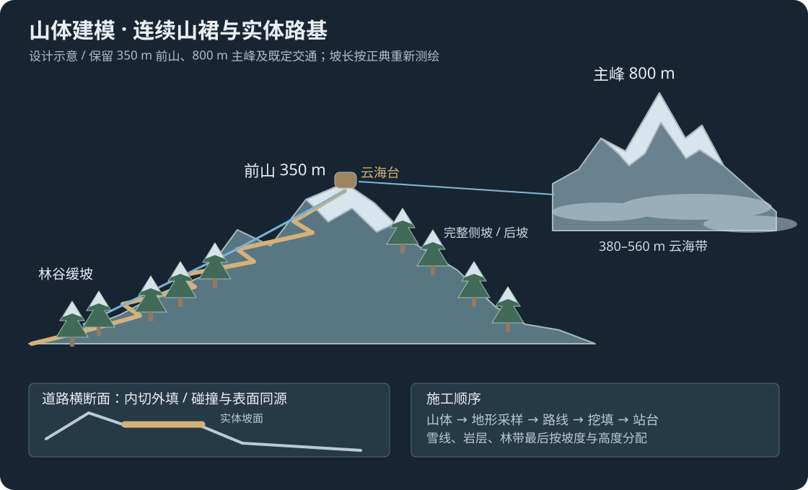
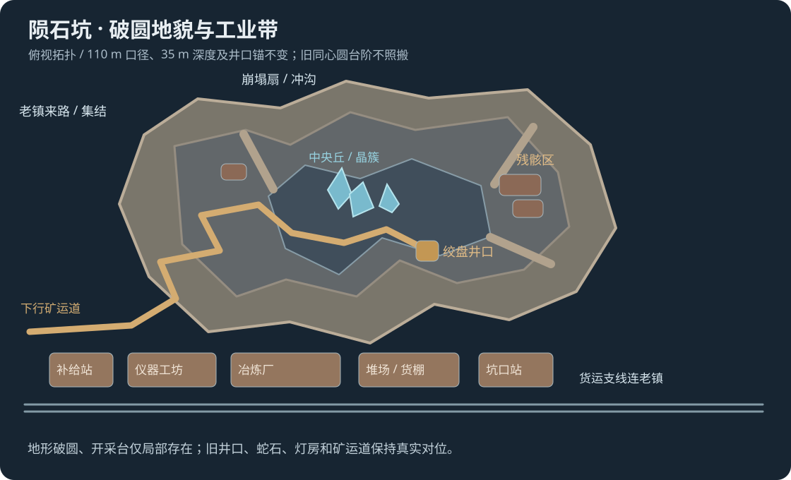
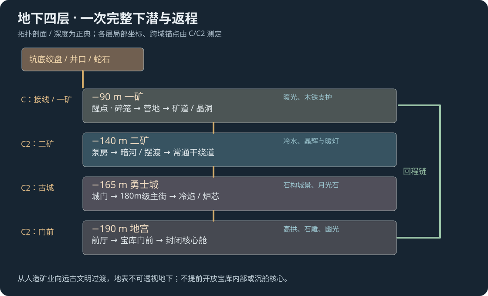

# 3.0-R 第二轮：三战区整体建模规格
日期 2026-11-25；用户最新裁定：六窗集中主攻陨石坑、山与地下，天空之城轻施工，宇宙线后置；物理、天气与性能总优化安排在最后。此稿替代第一轮六窗分工及天空优先级；接口、协作与串行合并规程仍有效。基线 integration 23a36fd5；第一轮PR #7 未合入，本轮续同PR，待总控接纳，不直接改正典或在飞代码。
## 1 世界总图与选图

[40张视觉施工图册](2026-11-25-3.0R-第二轮-40图视觉施工图册.md) 按 T/M/K/U 编号，4+14+10+12=40，全部引用现存仓内图，不是新生图。另有4张新绘制的布局剖面（可编辑SVG）是本轮方案，不是现有游戏渲染，尺寸非比例。
统一木石、雪岩、锈铁、晶蓝、暖光材质家族。以未写酒馆精细结构为近景标尺，非写实光追，不做百万小立方体堆积，不以物件密度或参考图物件数验收。正典锚点和旧镇冻结；用户新令允许重建山、坑的主体地形，涉及正典 terrain.ts 解冻/接口改造由总控确认，不能擅自改旧镇。
## 2 共用地形技术（A / D / B）
采用连续分块高度场＋必要局部洞穴网格。原地表 H0 保护区包括老镇建筑/桥/轨/入口；山 Hm 与坑 Hc 分区混合：H=H0+w_m(Hm-H0)+w_c(Hc-H0)，各权重在相应分区边界为0、过渡用 smoothstep，重叠区提前约定单一主责，不能把两个覆盖层叠上去。边缘共用采样/顶点，LOD 边界缝合、连续法线与材质；道路开挖/填方纳入最终 H 或有显式实体支撑的桥/栈道 surfaceId。先定接缝带与高程锚，独立生成后换真实适配器。旧视觉壳只在不可达远景，近景不再用假山、空气墙、DoubleSide补洞。地下洞道采用围合的实体地面/侧壁/顶，入口显式转场，不做表面可透视的底面。
地形基础/碰撞安全是建模前置；完整物理及性能专项留末轮。先让任意脚点对应可见就绪网格，不能等最终性能优化才修空白。
## 3 山域

正典：前山350m，镇域640×800 北延、峰顶旧锚(320,650)；主峰独立域约2200×1800，基底≈150m、绝顶800m，主脊+双次峰、平均坡面约26°；云海带380–560m。旧山口(290,300)、基站(526,329)、中山(440,520)、云海台、雪翼、兔龙猪星石等保留功能锚，若移高需一次性更新物理/站体/道具/联机。不可直接把旧近景墙或路带当真实山。
建模次序：
M-A 主体：用多峰/脊线控制的宽山裙，带支谷与鞍部；用低频地形噪声加各向异性岩脊、沟谷侵蚀，坡面自然过渡，禁止圆锥一排、直立白墙或仅南向壳。主峰全周完整；视觉远山只用低模且不可进入。
M-B 高度分层：山脚林谷→林间坡→中山岩台→雪线→云海台→主峰裸岩/冰川与绝顶雪帽。雪权重结合高程、坡度、背风坡和局部噪声；像素纹理区分雪、岩、土，积雪走坡面，不均匀撒锥。
M-C 道路：先按 Hm 选线路，约束坡度/转弯/净宽，沿等高线走，避陡坡、桥轨、建筑；内侧切坡外侧填坡/挡墙，路边羽化接本体。前山原2981m/≤12%（净宽≥2.5m），主峰≥5.4km/≤12%，若路线调整仍以原约束为准或提裁。高度多值时按玩家当前位置、surfaceId与连续路径选择，不取无限高层。转弯不抢相邻支撑面。
M-D 交通：前山缆车约516m三站，主峰约1920m二线，守天哨、绝顶小屋、观云亭、雪橇绝顶线≥6km、滑翔6:1只下不上。保留首次徒步登顶后放车及既定抢修规则，不能以快速传送替代。主峰转场保留正典，不再给镇→前山普通缝加黑场。
M-E 细节：松林只成簇出现，低海拔密、中段疏、绝顶无树；栏杆/路灯/歇脚点按场景功能，保证山脚、中山站、云海台、山背、绝顶五机位都能看出完整地貌。视图参照 M01-M14。
## 4 陨石坑

正典尺寸110m口径/35m深；保留中央丘6–9m/半径18–25m、井口及蛇石安全区、坑口 E2/N159、三层隔离、南侧矿运豁口、灯房/绞盘、工业带与铁路。旧几何不保外观，只保必要锚和功能。
K-A 地貌：用非圆的径向边界 R(theta) 与多处崩塌扇(原3处)/冲沟(原5处)/南侧豁口打断环状剖面；深度曲线连续，撞击层和后期开采局部台地分清；中央丘自然接坑底，井口旁足够操作空间。先空白地貌+路，逐步加装饰，禁止用环状阵列替代地形。坑沿至老镇雪原连续，外坡既非悬空片也非突起围墙。
K-B 坑内：视觉主题为残骸/断栈道、熔柱/晶簇、崩塌坡、黑石带/刻石、熔珠滩、井口作业区。保留原数量规格的叙事主体（熔柱、残段等），普通岩屑以岩层网格/贴图/局部实例化代替；先旁路 meteor-crater-interior-dressing 的纯装饰，不删权威矿点、灯、交互、碰撞。留足通行和视觉留白。
K-C 工业带：冶炼厂25–30m、高炉约10m、仪器双层厂房约20m，三塔12–15m、围墙5–6m、栅栏4.5–5m，按修订三下限保持。以功能结构分件：石基、承重柱、墙面、窗门、屋架/雪顶、烟囱、设备、货场，不能大立方体+噪点纹理；厂房与窄轨货运连通，补给站暖光核心，三塔可上。参考 K01-K10；K01只借布局/材质，不照抄规则漏斗。
K-D 衔接：西北路→守卫/塌口→补给站→坑沿→矿运路→坑底灯房→绞盘下井，回程同样成立。铁路山口站与坑口站联通，路轨贴实际地表；夜窗不改权威。视觉光链可读深浅，灯有物理来源。
## 5 地下世界

正典：-90一矿（水晶洞支线）、-140二矿暗河泵房、-165勇士城、-190地宫；现有二矿域复用，不另起系统。旧图参考 U01-U12。
U-A 一矿：升降井下降时从地表光过渡到窄井暖光，黑场入梦→醒点碎笼→营地火圈、旧镐、马石→主巷/晶洞猴石→返回笼与向下分岔。洞道不是平坦大房间，岩石拱顶、支护、轨枕、工具与事故痕迹构成地貌。正常挖矿遵白名单；地表不透视洞内。
U-B 二矿：洞厅主轴沿暗河，泵房在高岸，低水河床、正常摆渡、各水位恒通干绕道，河面不算普通步行支撑。两岸平台、护栏、支洞、矿车/供水痕迹、远近高差，以真实洞顶围合。与一矿、勇士城口接缝需 C 签发域锚。
U-C 勇士城：从窄洞口第一次看到城的全景，巨大岩洞内城门、约180m主街、两侧石屋、拱廊市集、半倒勇士像广场、可登城墙，铁匠铺/冷焰/酒馆安全袋，晶体与月光石照亮道路而不是满地重复小灯。城内主要建筑有室内；旧一代矿业与远古石构、封锁时代锈铁三层历史叠压。
U-D 地宫：高石拱、守库位、宝库门前狗石及既有遭遇；只开放正典门前空间，宝库/沉船核心锁闭。保留导航芯未来接口，原口径冲突由总控定，不为打通图方便提前开门。所有深层可按已定机制返程，死亡/断线按原权威。
## 6 天空之城与宇宙（降级）
仅修既有天空剪影、浮岛外壳/可安全抵达的已建范围与星港坪接口；不得为了本期新增大规模建筑、完整梦境规则或宇宙五舱。现有成果不删。原梦境章中巨树母树、飞行石、观测站、三魂、一次性活城/空城与第十三声太空门保留为下一期完整建设的设计依据。3.0结束不把天空章报完工，也不把未来门开放当本期验收。
## 7 阶段与验收
R1/R2 先完整地貌与主体（不等待所有玩法）；R3 修地形、碰撞、接缝；R4/R5 对图册细化材质、建筑与陈设；R6 接原有玩法与出入域、故事锚点；R7 自验/配对审核/串行合入。最后 P-OPT 独立全图性能物理天气优化轮，见任务分工文档，不能省。施工80%，测试20%封顶，构建/启动0错误/真走为日常。区块切换、真实地图边界、老镇无回归是硬门；不得用审查场景或假传送替代。
