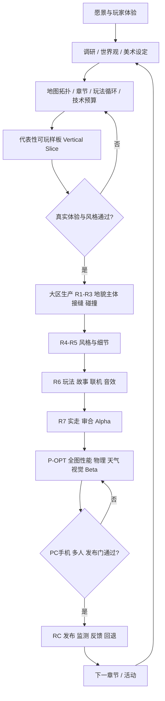

# 未写镇项目脑｜长期工程总则
2026-11-25 · 用户长期项目定位与唯一 D 盘根约束。不是新任务池，不重新派发历史任务。现役任务由 docs/交流区/现役/README.md 与看板激活（PR #7 合入后）。本文件是长期方法与硬约束；不替代世界观正典、区域规格或代码。新窗只需本页、AGENTS、现役入口及本线交接。
## 1 产品路线与长期边界
UNWRITTEN 2027 是可持续扩展的第一人称多人探索/生活世界，不是一次性跨年 demo。保持朋友网页一键进入、PC/手机可玩、原创精细体素/像素风。3.0-R 三重区为坑、地下、前山/主峰，天空轻维护，宇宙后置；末轮 P-OPT 不可省。跨年是一次发布里程碑而非终止点。未来按玩家反馈增加春节活动、章节、可扩容服务器；Steam 桌面发行与开源是远期选项，不等于已获批准或应现在迁引擎、公开仓库。保持平台抽象、授权资产台账、第三方署名、密钥与玩家数据隔离；开源前决定代码/资产/音乐/用户内容各自许可和公开范围；不公开私人存档、令牌、历史敏感信息。Steamworks 商店页与游戏构建审核独立，届时单独立项，当前不分散施工。
## 2 本地唯一落盘与准入
Windows 唯一仓库根 D:\computer learning\game_exe\kuanian，本身就是 Git 仓库。所有施工源、资产、截图、临时脚本、缓存、工作树均须在此根内（系统本身不可控的临时文件例外，不得主动将项目建在 C 盘/其他 D 盘目录）。禁止再套 unwritten-2027，禁止 DevSpace 默认托管 worktree 落到 C 盘，禁止以新聊天为由 clone/new worktree。DevSpace（用户称 DevSpeed）先恢复现有 workspaceId、路径和分支；若失效先绑定现役目录 checkout，绝不盲选 mode=worktree。不得复用他人正在写入的 checkout。路径按真实解析/大小写无关边界检查，根外或 junction 指向根外就停该写入、报总控，改做只读/其他合规任务。
长期目标：根 checkout=总控 integration；.worktrees/window-a,b,c,c2,d,d2 及经登记的真人线分别一线一棵长期工作树。现有 A/D 目录错位与 D2 根外尚待安全迁移，见本次审计，不把目标路径伪称已迁好。例外临时审查树必须总控登记理由、owner、截止条件，落 .worktrees/ 内；尽量复用单个审查槽，不再每个任务一棵。任何新成员的其他电脑也只登记一个明确工程根、一个仓库，不要求存在同名 D 盘。
项目持久文件沿既有 src/、tools/、public/、assets-source/、tests/、docs/；临时产物放根内 .evidence/、.npm-cache/ 或既有忽略目录，明确留存条件，不提交 node_modules、构建缓存、临时截图堆。避免多窗同时 npm install、构建、浏览器/压测、重复启动终端；在本机串行重负载，不开 watch 死循环。清理只处理自己的、已关闭、干净、有远端或可靠归档覆盖的工作树；不强删、不强推、不 reset --hard，不强制 stash 他人改动。
## 3 同步与融合（本地优先）
开工读 git worktree list、git status --short --branch、分支/HEAD/上游、git ls-remote 或 fetch 的真实远端，检查工作树路径、在飞任务、未提交/未追踪文件。先区分：①本地→对应远端分支是否一致；②对应分支→integration 的祖先/分歧；③integration→release→live；三者不可混为一谈。远端跟踪引用可能过期。fetch 只更新 refs，不盲 pull。清洁且纯落后才考虑 ff-only；分歧先审 unique commits/实际 diff，保全未提交文件，优先选取已审独立提交或补丁到最新集成基线，禁止整条多年分支盲合与跨窗覆盖。对每条线先处理现有候选与真实领地，不另造一堆分支。旧候选只有被证实合入/等价/明确归档才停写。每包本地编辑→构建/启动0真错/实走→提交自有分支→push→配对审实际候选SHA→总控串行合入→回填看板/交接→需要时发布。公共 viewer/terrain/presence 单写，不复制权威。PR 只包含该包，候选变更后重审；建议对 integration/release 设置禁强推/删、必要检查与总控审核（本次未配置）。总控唯一发布，记录可回退发布 SHA 与配置/数据迁移；healthz 回读不替代真人实玩。
## 4 真人 + 多智能体协作
规模三至五真人，保持轻量。线=负责人+分支+区域+模块命名空间+配对审核者；朋友线保留。新人先试玩/读本页/认领一件低耦合功能或资产；能直接做的可跳过培训，严禁共享 PAT 或生产凭据。总控拥有正典/任务激活/集成排序/发布权，线主负责局部设计和产出，配对窗审核，真人实玩最终验收。每项只一主，非主只读，跨域写契约（锚点/坐标/接口/行为），不等整个上游。一个人管理多智能体：总控拆成 2–6 个独立交付子包（按实际工具能力，不声称已运行不存在的 agent）；每包写任务ID、owner、允许路径、输入契约、输出、验证标准、下一无依赖项。每个子智能体只在已登记工作区内作业，不抢公共文件、不各开引擎。汇合点审合差分而不是拼接长聊天；有阻塞只停具体子包，立即转本线其他活。并行多做建模/设计，重负载验收串行。恢复新聊天读取现役入口及一张交接卡（路径、分支SHA、集成SHA、在飞任务、脏改动、未接线、下一项）；不递归读归档，不因旧文件有“最高优先”就复活旧任务。无合法任务就不制造空转或伪回执；自动化按当前任务和真实权限执行。
## 5 游戏开发全生命周期（大阶段 + 区域七轮）

- 预制作：定义玩家体验、探索动线、故事正典、地图坐标、参考图与材质标准，玩法核心循环，预算及风险；输出可执行区块规格，不扩张无关文档。
- 垂直切片：小而完整的生产宿主路径，例镇→坑沿→矿运道→升降井→一矿营地→返镇；同时验证可见地形/真实碰撞、第一人称、关键交互、风格、帧率，失败回设计。与现役大区施工并行，样板约束后续资产，不要求全窗停工。
- R1 大部分主体、R2 补完主体、R3 接缝碰撞及路线修复；前三轮必须有真实模型，不以文档和接口冒充。
- R4 参考图精修、R5 材质/结构/室内/环境叙事细节；同一机位日夜对比，不用物件数做美术指标。
- R6 玩法、事件、NPC、音效、多人和存档；核心规则提前定契约，完成时挂生产默认路径，保证单人可过和协作正典。
- R7 配对审合，候选入干且正常入口可达，未接线不能报完成。Alpha 目标是本期内容与核心系统完整可玩，不等于上线。
- Beta/P-OPT：区域齐后强制全图优化。建模阶段即保留空间块、LOD 和碰撞数据，末轮根据实测优化区块、可见距离/模拟距离/兴趣域分离、地下洞室剔除、曲面自适应细分、材质合批、内部面、实例化、光照与天气渐变、物理。近景质感不被粗暴牺牲；高处仅保远景低模。目标 PC≥60/中端手机≥30 FPS、draw≤300、可见三角≤150万（原定目标，非当前实测）。同机位同设备前后对比，记录帧时间与长帧、冷启动、内存和网络负荷；实际真机与两人跨域实玩。80%施工优化/20%验证上限，日常三门、切版一次全量。
- RC 发布候选：修阻断，备份世界与必要存档/配置，回退演练，正常公网路径与版本验证；版本号/变更说明、玩家反馈闭环。新版本再走此循环。弱服务器以负载实测和成本预算逐步扩容，不先承诺并发容量。未来平台封装/分发与开源审查另立决策。
## 6 调研依据（方法转译，不照搬组织规模）
Git 官方 worktree 文档 https://git-scm.com/docs/git-worktree ：一仓多工作树、move/remove/prune 的登记管理；不能手工剪切后假装登记正确。GitHub PR 管理 https://docs.github.com/en/pull-requests/reference/managing-and-standardizing-pull-requests 与 protected branches https://docs.github.com/en/repositories/configuring-branches-and-merges-in-your-repository/managing-protected-branches/about-protected-branches ：以明确候选、检查与受保护主线避免并发覆盖。游戏生产参考 https://www.gamedevfoundry.com/StagesOfGameDevelopment.html ：vertical slice / production / alpha / beta；本项目结合已有七轮而非照搬大团队流程。Steamworks https://partner.steamgames.com/doc/store/releasing 与 https://partner.steamgames.com/doc/store/review_process ：商店及构建审查另期准备。仓内 docs/ART.md 已有爱丽丝样板制作路线、酒馆实景参考，docs/PLAN.md 为历史需求与技术记录；现行正式生产以实测 Three.js/Node 宿主为准，不把旧 Voxelize 实验当已替换全图。三轮 3.0-R 文档为现役设计候选。
